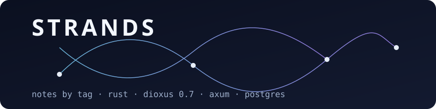

<div align="center">
  

  <p align="center">
    
    
    
    
  </p>
</div>

## Quick Links

- [What is it?](#what-is-it) · [Features](#features) · [Layout](#layout) · [Quickstart](#quickstart) ·
  [Development](#development) · [Contributing](#contributing)

## What is it?

Strands is a notes-by-tag app in pure Rust: a Dioxus 0.7 WASM SPA on mobile and
desktop, talking to one self-hosted axum service that owns the store. Tags are the
navigation — a note is anything captured with a source attached.

## Features

- **Notes first** — capture text, links, photos, places; the store is the source of truth
- **Tag grid** — home is the tag surface, not a feed
- **Capture with sources** — every note records where it came from
- **Connectors** — plugin seam for new sources (Google Photos, WhatsApp, Maps in v1)
- **Server-owned** — one Rust service, Postgres via sqlx, no client-side database

## Layout

- `crates/core` — domain types (`Note`, `Tag`, `Source`), no IO, no framework deps
- `crates/server` — axum binary, serves the API and the SPA bundle (currently `GET /healthz`)
- `crates/web` — Dioxus 0.7 web-only SPA (no SSR), built to WASM with `dx build`

## Quickstart

```sh
cargo run -p strands-server
curl http://localhost:8080/healthz   # => {"status":"ok"}
```

The SPA needs the dioxus CLI:

```sh
cargo install dioxus-cli --version 0.7.10 --locked
dx build --package strands-web --platform web --release
```

## Development

The toolchain is pinned in `rust-toolchain.toml` (stable plus the
`wasm32-unknown-unknown` target); `rustup` installs it on first use in this directory.

```sh
cargo fmt --all --check
cargo clippy --workspace --exclude strands-web --all-targets -- -D warnings
cargo test --workspace --exclude strands-web
```

`strands-web` has no native target, so the `lint-test` workflow builds and gates it:
the `wasm-build` job reports the release bundle size as an artifact and fails above
5 MiB.

`pre-commit install` wires the same fmt/clippy gate into git.

## Contributing

Pull requests follow `.github/pull_request_template.md` and conventional commit
messages. CI must be green before merge; UI changes carry visuals in the PR body.
